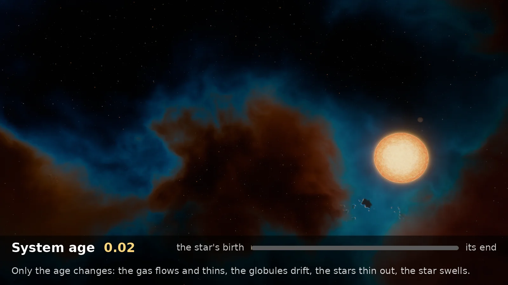
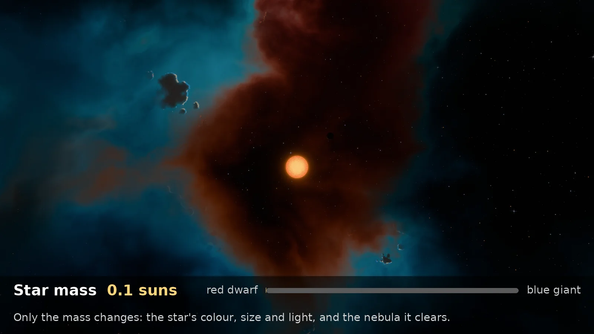
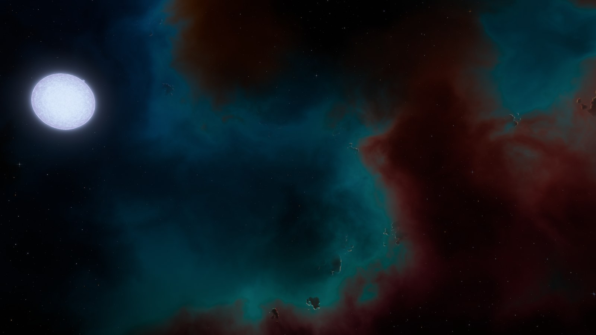
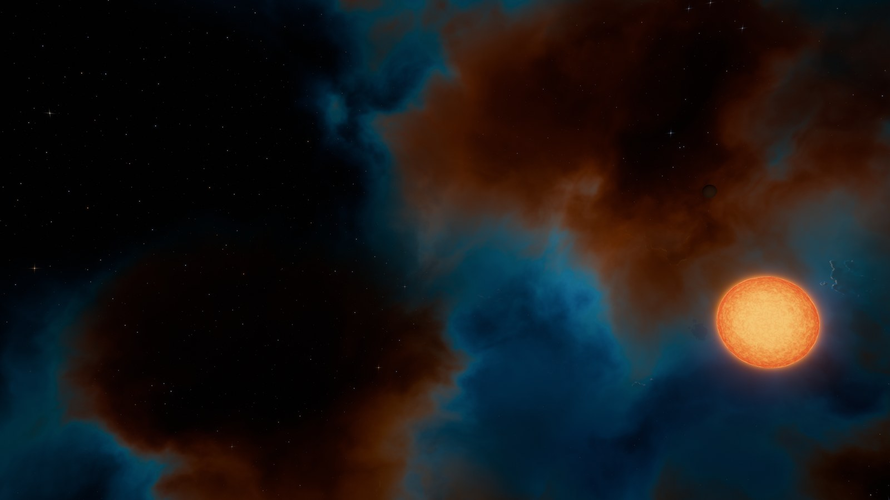
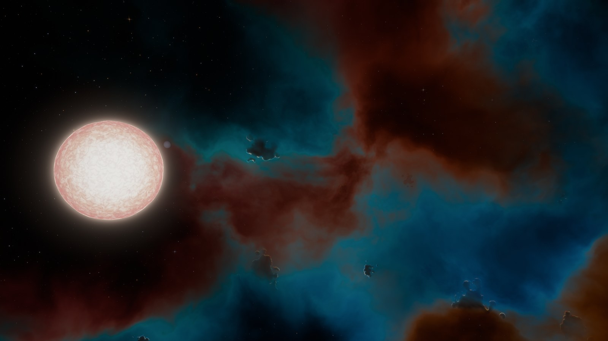
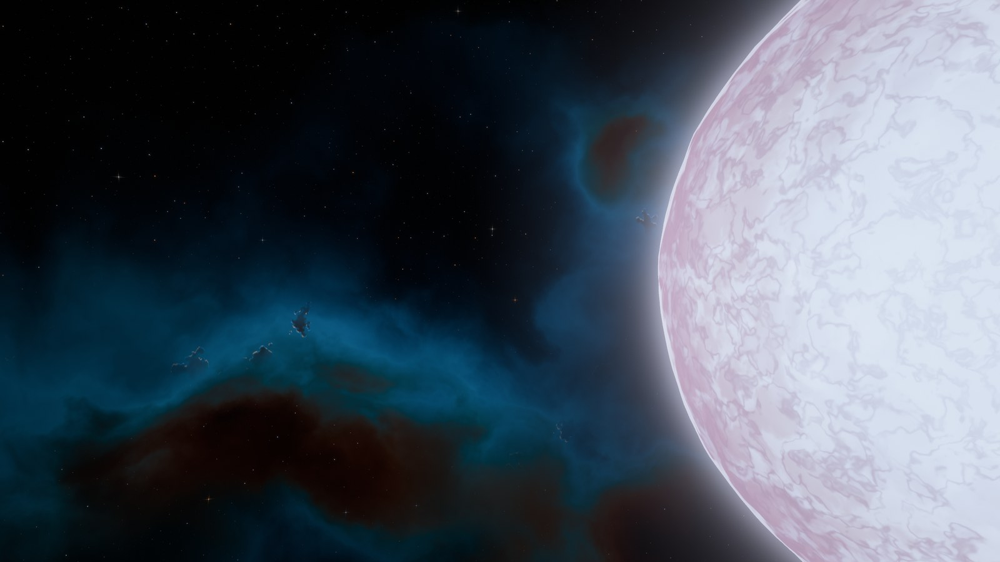
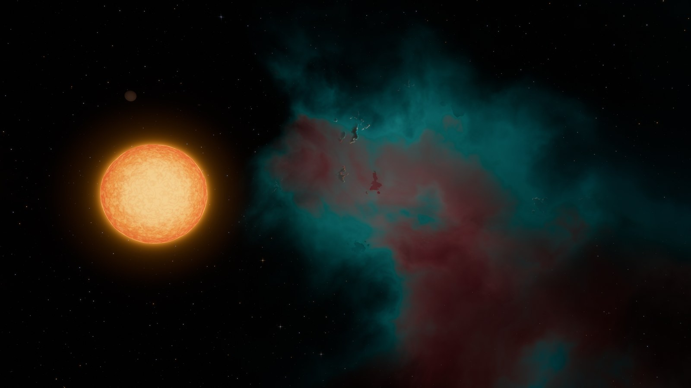

# bevy-planet

A Rust + [Bevy](https://bevyengine.org) 0.20 game exploring procedural planet generation at two linked scales.



*One star system through its star's life, from one seed: only the age changes. The nebula's gas flows and thins as the star clears it, the dark Bok globules drift with it, the starfield thins out, and the star ends as a red giant.*

> LEARNING project. The code is written by the learner; a tutor agent (`.claude/agents/tutor.md`) guides, documents and watches over quality, but never codes in his place.

## Vision

- Orbital view -- the whole planet, generated "low-res", that you can observe and rotate.
- First-person view -- you "enter" the world and end up on the surface, in a much more detailed terrain.
- Consistency -- both views share the SAME procedural generation function (single source of truth); the level of detail changes, not the relief. The core of the project is the mapping between the two coordinate systems.

## Spirit

A contemplative god game: the player assembles star systems and documents the life born in them, unique to each system because each system is unique. The world decides life: the player acts on causes and watches the consequences, and a single seed describes everything, from the nebula that birthed the star down to the ground.



*One cause, its consequences: only the star's mass changes, from a red dwarf to a blue giant. Its colour, size and light follow, and so does the nebula it clears.*

## Gallery

Five systems, each from its own seed and its own star.



*A wide range of colours in one cloud, a blue giant beside it (seed 34).*

| | |
|---|---|
|  |  |
| *Orange and blue gas curling around a red dwarf (seed 40).* | *Globules backlit in the gas's filaments, by a young white star (seed 26).* |
|  |  |
| *The boiling limb of a young blue star, globules on the gas's crest (seed 30).* | *A rarer palette, pink and teal, by an orange star (seed 29).* |

## Status

A living star system, all derived from a seed, an age and a metallicity: a physically driven star with a living surface, a GPU-baked nebula with Bok globules and a per-pixel starfield, evolving continuously with the system. Planets are next. See `CHANGELOG.md`.

## Requirements

- Rust >= 1.97.1 (`rustc`, `cargo`) -- developed on the latest stable
- System dependencies, plus `clang` + `lld` (the build links with `lld` via `app/.cargo/config.toml`) on Linux Ubuntu 24.04+:

  ```bash
  sudo apt install -y libwayland-dev libxkbcommon-dev libasound2-dev libudev-dev libx11-dev clang lld
  ```

## Getting started

```bash
make run        # run the game (dev, dynamic linking)
make check      # fmt + clippy + tests (must pass before committing)
make help       # list all targets
```

The first build compiles all of Bevy (several minutes); subsequent builds are fast.

## Structure

```bash
bevy-planet/
|-- app/                # the Rust crate (the game, written by the learner)
|   |-- Cargo.toml      #   dependencies + build profile
|   |-- src/            #   game source code
|   |-- assets/shaders/ #  WGSL shaders, mirroring src/
|-- docs/               # living documentation
|   |-- images/         #   README captures
|   |-- technical.md    #   architecture, modules, algorithms
|   |-- functional.md   #   the gameplay experience
|   |-- logbook.md      #   session logbook
|-- .claude/agents/     # tutor agent definition
|-- Makefile            # dev workflow (drives cargo inside app/)
|-- CHANGELOG.md        # version history
|-- CLAUDE.md           # context + pedagogical contract
```

## Documentation

- [Technical doc](docs/technical.md)
- [Functional doc](docs/functional.md)
- [Logbook](docs/logbook.md)
